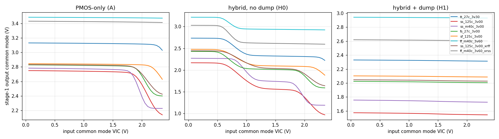
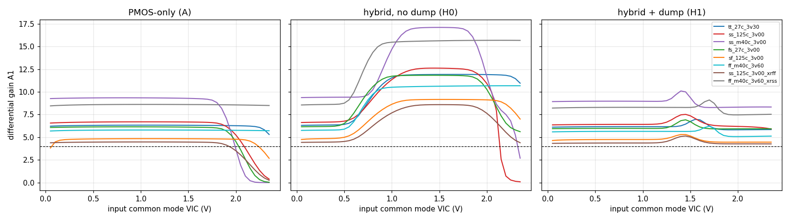
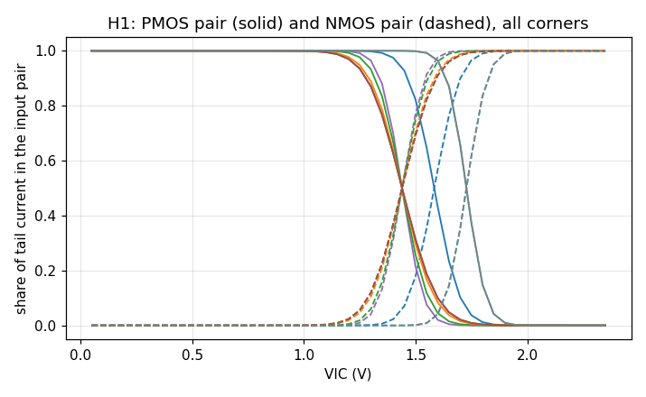
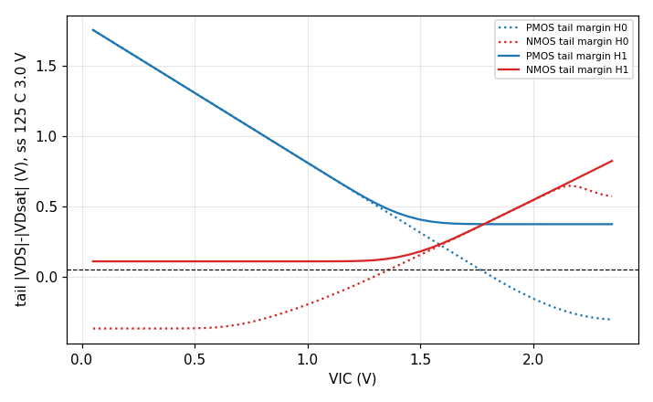

# SPIKE_STAGE1: does the hybrid input stage with dump devices hold its common mode and gain over 0.05-2.35 V?

Task T1 (PLAN_V2 S0, findings C4, C8, C12). Written 2026-11-11. **Verdict: yes. The hybrid stage with dump devices
(variant H1) passes every stage-1 criterion at all 8 corners with a CM span of at most 31 mV (limit +-150 mV), A1 between
4.26 and 10.1, A1 spread at most 1.27x (limit 2.2x) and all device saturation margins at least 88 mV (limit 50 mV).
The same circuit without the dump devices (H0) fails the CM criterion at 7 of 8 corners (CM span up to 1.2 V) and its gain
collapses to 0.08 at ss/125 C at the top of the range.** The stage-1 topology for the real design is therefore the baseline
of PLAN_V2 4.1: hybrid complementary input, folded PMOS path, resistor loads, dump devices gated by Vref = 0.48*VDD. No
fallback-ladder rung is taken (R5 stays at rung 0). This file is generated from `sim/spike_stage1/doc_template.md` by
`sim/spike_stage1/make_doc.py`; every number in the tables comes from `results/spike_stage1.json`.

## 1. What was built

Stage 1 only, ideal bias, 30 fF load per output (assumption: stage-2 pair gate plus wiring). Per lane (H1):

```
VDD -+------------------+---- RL (ppolyf_u_1k, body VSS) ----+
     |                  oa                                   ob
 PMOS tail MPT          |  NMOS pair MN1/MN2 + dump MND1/2    |   drains straight into oa / ob
     tp                 |  (gates inp/inn, dump gates Vref)   |   (tail MNT to VSS, tail node tn)
 PMOS pair MP1/MP2 + dump MPD1/2 (n-well = tp)               |
     fa  -> M5a (cascode, gate VB2) -> oa      fb -> M5b -> ob
     M3a (sink, gate VBN) to VSS               M3b to VSS
```

* **Dump = a third pair of identical devices** (same W, L, nf as the input pair devices) whose gates sit at Vref = 0.48*VDD and whose
  drains go to the same two nodes the pair drives (oa/ob for NMOS, fa/fb for PMOS). With identical devices on a shared tail
  node the pair and the dump form a current switch: the pair takes the tail current when VIC is on its side of Vref, the dump takes
  it otherwise, and either way the *common-mode* current into RL and into the fold nodes is the same. RL carries
  I3 - Itp/2 + Itn/2 = I3 for all VIC.
* **Ideal bias** = ideal reference currents into diode-connected replicas (so VGS tracks the corner and the mirror ratios are
  real: one NMOS diode VBN biases the tail MNT and both sinks M3, one PMOS diode biases MPT, a replica of M5 on an ideal
  offset Vf gives VB2 = Vf + VGS5), an ideal Vref = 0.48*VDD, and a corner scale factor ibs on all reference currents
  (1.33 at ss/125 C, 0.78 at ff/-40 C, else 1.0: PLAN_V2 C7b).
* **Variants** (same sizes): A = PMOS pair only (Option A, the flow shake-down; sinks reduced so RL carries the same current),
  H0 = hybrid without dump (control experiment), H1 = hybrid with dump (candidate).
* **Corners** (8): tt 27 C 3.3 V; ss 125 C 3.0 V; ss -40 C 3.0 V; fs 27 C 3.0 V; sf 125 C 3.0 V; ff -40 C 3.6 V (the six of the task) plus the
  two resistor cross corners ss/125 C/3.0 V with res_ff and ff/-40 C/3.6 V with res_ss. Sweep VIC = 0.05 to 2.35 V in 47 steps of
  50 mV, each step one harness run (op + AC), 1128 runs in about 25 s on 6 jobs, all status ok.

Files: `sizing/spike_stage1.py` (sizes and writes the three decks), `sim/spike_stage1/{tb_spike_*.spice,spike_*.json,hooks.py,analyze.py,run_all.sh}`,
`results/spike_stage1.json`, `results/spike_stage1_sizing.json`, `results/iterations.jsonl`, plots in `sim/spike_stage1/plots/`.
Re-run: `docker exec apic_headless bash /foss/designs/.claude/worktrees/lvds-rx/analog/lvds_rx/tools/cx bash sim/spike_stage1/run_all.sh`.

## 2. How each size was chosen (gm/ID method, book via docs/GMID_METHOD_NOTES.md)

Every W is `W = ID / (ID/W)` at the chosen gm/ID, L, VDS and VSB (book eq. 3.8-3.9, pp.110-112), through `gmid_gf180.size()`;
L is on the LUT grid; `nf` keeps the finger near 5 um (2.5 um for the NMOS mirror unit) with `wnflag=1`. The "assumption" column is what
the LUT lookup used; the simulator then recomputes the real operating point (section 5).

| device | role | gm/ID | L (um) | W (um) / nf | ID | reason (book) |
|---|---|---|---|---|---|---|
| MN1/2 + MND1/2 | NMOS pair + dump twins | 15 | 0.5 | 34.3 / 7 | 48 uA each | Moderate inversion: A1 = gm/ID x VR (eq. 3.13-3.14, pp.153-156) so a higher gm/ID buys gain without current; fT = 2.4 GHz stays far above the 100 Mb/s need (fT/10 rule, p.99). L = 0.5 keeps the L-offset penalty off the matching (Leff = L - 0.15). |
| MP1/2 + MPD1/2 | PMOS pair + dump twins | 15 | 0.4 | 99.6 / 20 | 51 uA each | Same reasoning; PMOS current density is 3.5x lower so W is large (fT = 0.79 GHz, Cgg about 150 fF per device). L = 0.4 is the shortest on the grid that is present in every corner table with margin to 0.28 where Leff matters (handoff 7.3 item 5). Dump twins must equal the pair devices, otherwise the switch point is not at Vref. |
| MNT | NMOS tail | 7 | 1.0 | 20 / 8 | 97 uA | Low VDsat (2/(gm/ID) = 0.29 V, eq. 2.34, p.82) leaves room above the pair; L = 1 for output resistance and matching of the mirror. Not cascoded (CM range, book 5.2). |
| MPT | PMOS tail | 7 | 1.0 | 90 / 18 | 101 uA | Same. |
| M3a/b | NMOS sinks | 7 | 1.0 | 25 / 10 | 121 uA each | Same inversion and L as MNT so ONE diode (VBN) biases both and the ratio is an integer (10 : 8 units). I3 = 1.2 Itp so M5 keeps 20 uA even when the PMOS pair steers fully. |
| M5a/b | NMOS cascodes | 10 | 0.5 | 15.4 / 4 | 70 uA each | Short L for the fold pole (eq. 6.38), gm/ID 10 for gm5 = 0.70 mS and 50 mV headroom rule (5.2.1, p.247). |
| RL | load | n/a | n/a | 2 x (W 2 um, L 16.5 um) `ppolyf_u_1k` | 8.44 kohm | RL = VR / I3 with VR = 1.0 V at tt; same poly as the future bias resistor so the gain is a geometry ratio (eq. 5.7). |

Predicted small-signal numbers (sizing script, LUT, tt): A1 PMOS path 6.33, NMOS path 6.12, kappa (fold transfer) 0.986,
signal-path supply current 340 uA (2 I3 + Itn). The simulator gave A1 6.11 and 5.84 (section 5) and 421 uA total at tt, the difference being the
ideal reference currents of the bias replicas (88 uA, mostly the M5 replica at full current; a real bias scales them down). The 1.5 mA lane budget is not at risk.

## 3. Iterations (results/iterations.jsonl; 2 of 8, 2 of 5 for the block)

| # | knobs | result |
|---|---|---|
| 1 | initial: VR 0.9 V, pair gm/ID 14, Vf 0.50 V, I3/Itp 1.2 | CM span 10-28 mV, spread <= 1.27, margins >= 65 mV (all good). A1 at the extremes 3.75 (sf/125 C) and 3.55 (ss/125 C, res_ff) < 4: FAIL. The 10 %/10 % hand-over width was 0.20-0.33 V: see D-002 for why that quantity was replaced. |
| 2 | VR 1.0 V, pair gm/ID 15, Vf 0.45 V | all gates PASS at all 8 corners (tables below). Chosen. |

## 4. Results

### Hybrid + dump (H1): the candidate, per corner

| corner | CM min..max (V) | CM span (mV) | A1 at 0.05 / 2.35 V | A1 min..max over VIC | spread (47 pts / TB2 7 pts) | N/P overlap (V) / Vref margin (V) / handover width 10 % (V) | min margin (mV, device) | f3dB min (MHz) | verdict |
|---|---|---|---|---|---|---|---|---|---|
| tt_27c_3v30 | 2.313..2.330 | 17 | 6.11 / 5.84 | 5.82..6.97 | 1.20 / 1.06 | 1.251 / 0.566 / 0.238 | 212 (m3a) | 222 | PASS |
| ss_125c_3v00 | 1.545..1.575 | 30 | 6.36 / 5.91 | 5.91..7.52 | 1.27 / 1.10 | 0.683 / 0.254 / 0.314 | 88 (m3a) | 180 | PASS |
| ss_m40c_3v00 | 1.726..1.756 | 31 | 8.93 / 8.33 | 8.27..10.10 | 1.22 / 1.08 | 0.637 / 0.283 / 0.208 | 185 (mnt) | 170 | PASS |
| fs_27c_3v00 | 2.005..2.024 | 20 | 5.94 / 5.93 | 5.92..6.92 | 1.17 / 1.01 | 0.943 / 0.437 / 0.241 | 215 (m3a) | 222 | PASS |
| sf_125c_3v00 | 2.086..2.102 | 16 | 4.64 / 4.46 | 4.45..5.30 | 1.19 / 1.08 | 1.068 / 0.356 / 0.293 | 106 (mp1) | 216 | PASS |
| ff_m40c_3v60 | 2.930..2.941 | 12 | 5.59 / 5.12 | 5.07..6.21 | 1.22 / 1.11 | 1.466 / 0.622 / 0.194 | 283 (mp1) | 272 | PASS |
| ss_125c_3v00_xrff | 2.027..2.047 | 20 | 4.32 / 4.26 | 4.26..5.13 | 1.20 / 1.04 | 0.681 / 0.252 / 0.314 | 90 (m3a) | 263 | PASS |
| ff_m40c_3v60_xrss | 2.602..2.619 | 17 | 8.21 / 7.53 | 7.46..9.11 | 1.22 / 1.11 | 1.465 / 0.622 / 0.194 | 285 (mp1) | 189 | PASS |

### Control without dump devices (H0): what the dump has to cure

| corner | CM min..max (V) | CM span (V) | A1 at 0.05 / 2.35 V | spread (47 pts) | PMOS tail valid up to (V) | NMOS tail valid from (V) | overlap, review definition (V) |
|---|---|---|---|---|---|---|---|
| tt_27c_3v30 | 2.222..2.734 | 0.512 | 6.31 / 10.96 | 1.89 | 2.269 | 1.018 | 1.251 |
| ss_125c_3v00 | 0.965..2.166 | 1.201 | 6.62 / 0.08 | 150.77 | 1.869 | 1.186 | 0.683 |
| ss_m40c_3v00 | 1.186..2.270 | 1.084 | 9.37 / 2.69 | 6.36 | 1.794 | 1.157 | 0.637 |
| fs_27c_3v00 | 1.587..2.429 | 0.842 | 6.15 / 5.61 | 2.11 | 1.877 | 0.934 | 0.943 |
| sf_125c_3v00 | 1.880..2.476 | 0.596 | 4.75 / 7.00 | 1.93 | 2.152 | 1.084 | 1.068 |
| ff_m40c_3v60 | 2.925..3.216 | 0.292 | 5.75 / 10.67 | 1.86 | 2.350 | 0.884 | 1.466 |
| ss_125c_3v00_xrff | 1.635..2.442 | 0.807 | 4.43 / 4.39 | 1.96 | 1.869 | 1.188 | 0.681 |
| ff_m40c_3v60_xrss | 2.594..3.030 | 0.435 | 8.55 / 15.67 | 1.83 | 2.350 | 0.885 | 1.465 |

### PMOS-only, Option A (shake-down variant)

| corner | CM min..max (V) | CM span (V) | A1 at 0.05 V | A1 at 1.3 V | PMOS tail valid up to (V) |
|---|---|---|---|---|---|
| tt_27c_3v30 | 3.031..3.132 | 0.102 | 6.22 | 6.32 | 2.269 |
| ss_125c_3v00 | 2.137..2.750 | 0.612 | 6.56 | 6.69 | 1.869 |
| ss_m40c_3v00 | 2.226..2.783 | 0.557 | 9.26 | 9.32 | 1.793 |
| fs_27c_3v00 | 2.399..2.828 | 0.430 | 6.08 | 6.13 | 1.876 |
| sf_125c_3v00 | 2.629..2.845 | 0.216 | 3.81 | 4.84 | 2.152 |
| ff_m40c_3v60 | 3.475..3.488 | 0.013 | 5.69 | 5.79 | 2.350 |
| ss_125c_3v00_xrff | 2.423..2.832 | 0.409 | 4.39 | 4.47 | 1.869 |
| ff_m40c_3v60_xrss | 3.414..3.433 | 0.019 | 8.45 | 8.61 | 2.350 |

### Dump devices at work (H1): where each pair hands over, tail-current constancy

| corner | Vref (V) | PMOS pair share = 50 % at VIC (V) | NMOS pair share = 50 % at VIC (V) | both pairs >= 10 % from..to (V) | gm(P)+gm(N) min/max | I_tail,P span (%) | I_tail,N span (%) | idd mean (uA) | idd span (uA) |
|---|---|---|---|---|---|---|---|---|---|
| tt_27c_3v30 | 1.584 | 1.584 | 1.584 | 1.464..1.702 | 0.82 | 2.4 | 1.7 | 421 | 1.6 |
| ss_125c_3v00 | 1.440 | 1.440 | 1.440 | 1.285..1.599 | 0.81 | 2.5 | 2.5 | 557 | 3.1 |
| ss_m40c_3v00 | 1.440 | 1.440 | 1.440 | 1.333..1.541 | 0.81 | 3.1 | 2.7 | 419 | 2.6 |
| fs_27c_3v00 | 1.440 | 1.440 | 1.440 | 1.321..1.562 | 0.85 | 2.6 | 2.1 | 422 | 2.0 |
| sf_125c_3v00 | 1.440 | 1.440 | 1.440 | 1.296..1.589 | 0.83 | 2.1 | 2.1 | 421 | 2.0 |
| ff_m40c_3v60 | 1.728 | 1.728 | 1.728 | 1.628..1.823 | 0.81 | 2.5 | 1.6 | 330 | 1.2 |
| ss_125c_3v00_xrff | 1.440 | 1.440 | 1.440 | 1.285..1.599 | 0.82 | 2.5 | 2.5 | 557 | 3.1 |
| ff_m40c_3v60_xrss | 1.728 | 1.728 | 1.728 | 1.628..1.823 | 0.81 | 2.5 | 1.6 | 330 | 1.2 |

### Saturation margins |VDS|-|VDsat| (mV), minimum over the VIC sweep, H1

| device | tt_27c_3v30 | ss_125c_3v00 | ss_m40c_3v00 | fs_27c_3v00 | sf_125c_3v00 | ff_m40c_3v60 | ss_125c_3v00_xrff | ff_m40c_3v60_xrss |
|---|---|---|---|---|---|---|---|---|
| m3a | 212 | 88 | 251 | 215 | 139 | 288 | 90 | 287 |
| m3b | 212 | 88 | 251 | 215 | 139 | 288 | 90 | 287 |
| m5a | 1682 | 826 | 1126 | 1378 | 1400 | 2352 | 1307 | 2024 |
| m5b | 1682 | 826 | 1126 | 1378 | 1400 | 2352 | 1307 | 2024 |
| mn1 | 939 | 179 | 527 | 559 | 685 | 1518 | 660 | 1191 |
| mn2 | 939 | 179 | 527 | 559 | 685 | 1518 | 660 | 1191 |
| mnd1 | 1004 | 286 | 584 | 623 | 770 | 1559 | 764 | 1233 |
| mnd2 | 1004 | 286 | 584 | 623 | 770 | 1559 | 764 | 1233 |
| mnt | 396 | 110 | 185 | 354 | 207 | 649 | 113 | 648 |
| mp1 | 324 | 329 | 536 | 415 | 106 | 283 | 327 | 285 |
| mp2 | 324 | 329 | 536 | 415 | 106 | 283 | 327 | 285 |
| mpd1 | 393 | 427 | 600 | 486 | 181 | 333 | 424 | 335 |
| mpd2 | 393 | 427 | 600 | 486 | 181 | 333 | 424 | 335 |
| mpt | 662 | 374 | 336 | 410 | 669 | 941 | 374 | 941 |

### Same judge on the variants that must not pass (corners failing each criterion)

| variant | CM +-0.15 V | A1 at the extremes >= 4 | spread <= 2.2 | worst CM span (V) |
|---|---|---|---|---|
| A | 4 of 8 | 5 of 8 | 4 of 8 | 0.61 |
| H0 | 7 of 8 | 2 of 8 | 2 of 8 | 1.20 |

### LUT prediction vs SPICE at tt (the sizing script against the simulator)

| device (state) | VIC (V) | ID pred (uA) | ID sim (uA) | error | gm/ID pred | gm/ID sim | VGS pred (V) | VGS sim (V) |
|---|---|---|---|---|---|---|---|---|
| mp1 | 0.05 | 50.7 | 51.7 | +2.0 % | 15.0 | 14.7 | 0.837 | 0.845 |
| mpd1 | 1.95 | 50.7 | 50.5 | -0.3 % | 15.0 | 15.1 | 0.837 | 0.833 |
| mn1 | 2.35 | 48.3 | 48.7 | +0.8 % | 15.0 | 14.7 | 0.958 | 1.095 |
| mnd1 | 0.05 | 48.3 | 47.9 | -0.9 % | 15.0 | 14.8 | 0.958 | 0.943 |
| m5a | 1.25 | 70.1 | 67.9 | -3.2 % | 10.0 | 10.0 | 1.000 | 0.986 |
| m3a | 1.25 | 120.8 | 118.7 | -1.7 % | 7.0 | 6.9 | - | 0.932 |
| mnt | 1.25 | 96.7 | 95.8 | -0.9 % | 7.0 | 6.9 | - | 0.932 |
| mpt | 1.25 | 101.4 | 101.7 | +0.4 % | 7.0 | 7.0 | - | 1.035 |

A1 predicted / simulated at tt: PMOS path 6.33 / 6.11, NMOS path 6.12 / 5.84










## 5. What the numbers mean

* **The dump works as a current switch and holds the common mode.** Both pairs hand over at exactly Vref (the 50 % crossing sits at 0.48*VDD in
  every corner), the tail currents vary by only 1.6-3.1 % over the whole VIC range, and the CM moves 12-31 mV where the dump-free circuit moves
  0.29-1.2 V. The residual is the Early effect of the tails and the cascode.
* **Gain is flat.** A1 varies at most 1.27x over the sweep (1.11x over the seven TB2 points); the sum gm(P)+gm(N) dips to 0.81-0.85 of its maximum at the
  hand-over, because two half-on pairs give less total gm than one fully-on pair in moderate inversion. There is no gain peaking (peak/DC = 1.0 in H1).
  Without the dump A1 doubles inside the overlap (and falls to 0.08 at ss/125 C at 2.35 V: the NMOS tail leaves saturation because the CM has dropped).
* **Bandwidth is not the limit.** -3 dB at least 170 MHz in every corner and at every VIC with 30 fF per side (limit for a stage: 80 MHz = 0.8 x DR).
* **N/P overlap, and why the dump-free control is used for it.** The spec quantity (0.25 V, "measured 0.33 V at ss/3.0 V" in `log/review_circuit.md`) is the VIC range in which both pairs' tail
  transistors carry at least 90 % of their plateau current. With dump devices the tails never leave saturation, so that range is the whole sweep
  and the number is meaningless. It is therefore measured on the control H0 (same sizes, no dump), where it is 0.64 V at ss/-40 C, 0.68 V at ss/125 C and
  0.94-1.47 V elsewhere (the review's 0.33 V was a cruder tail model), and the functional requirement on the dump is stated as
  **Vref must lie at least 0.125 V (half the limit) inside that window on both sides**: the margin is 0.252 V at worst (ss/125 C with res_ff), i.e. Vref could be off by about 17 % of its value
  (0.25 V) before the dump loses saturation. The pair hand-over width itself (both pairs at least 10 %) is 0.19-0.31 V and is only informational. This is an interpretation for the new architecture, not a
  changed limit (decision D-002; `spec/gates.yaml` untouched).
* **Saturation margins.** The tightest devices are the sinks M3 (88 mV at ss/125 C: their VDS is the fold-node voltage, about 0.45 V, and the slow hot corner needs more VDsat), the NMOS tail (110 mV at ss/125 C
  at low VIC, where the dump holds the tail node at Vref - VGS) and the PMOS pair (106 mV at sf/125 C at VIC = 0.05 V). All are above the 50 mV limit; the NMOS pair
  at VIC = 2.35 V, the device the CM level protects, keeps 179 mV at ss/125 C and 0.5-1.5 V elsewhere (full table above).
* **LUT against SPICE** (table above): IDs within 3.2 %, gm/ID within 2 %, A1 within 3.5-4.6 % low. The NMOS pair VGS differs (1.095 V against 0.958 V) only because the LUT was read at VSB = 0.7 V (the design
  centre) while the table row is taken at VIC = 2.35 V, where the body effect has raised VSB to about 1.3 V; current and gm/ID are right.
* **Absolute CM** (H1 mean over VIC): 2.32 V at tt, 1.56 V at ss/125 C, 2.94 V at ff/-40 C. This follows the ideal-bias model (the +33 %/-22 % current scale times the resistor corner) and is not a pass criterion
  of the spike, but stage 2 must accept 1.5-3.0 V at its input. A V/R-replica bias (VR = geometry ratio x (VDD - VGS)) would narrow this; that is a bias-design question for T2/T3.
* **Option A (PMOS only).** Usable up to the PMOS tail validity limit: 1.79 V (ss/-40 C), 1.87 V (ss/125 C), 1.88 V (fs), 2.15 V (sf), 2.27 V (tt), 2.35 V (ff). Above that the gain falls below 4 and
  the CM drops by up to 0.61 V. As planned (C12) it is a flow shake-down only.

## 6. What the spike did not test (so T2 and later must)

* **Mismatch.** No Monte Carlo here. The dump twins are not free in offset: when one pair is off, the dump twin of that type carries the current and its pair mismatch (sigma about
  7.1 mV*um/sqrt(W*Leff) = 2.1 mV for the NMOS twins at W*Leff = 12 um2, PMOS twins larger) appears at the input almost one-to-one, adding in quadrature to the active pair's. The budget of C3 must include it.
  A lever that is **reasoned, not simulated**: make the dump twins k times wider than the pair devices. In moderate inversion this moves the hand-over by about n*UT*ln(k) = 25 mV (k = 2) to 50 mV (k = 4),
  well inside the 0.25 V window, and reduces their offset contribution by sqrt(k).
* **Large signal.** VID = 0 only. With I3/Itp = 1.2 the cascode keeps 20 uA when the PMOS pair steers fully; the shape of tPD versus VID and VIC is a TB4 question.
* **Real bias.** Ideal currents, ideal Vref and Vf. A resistor-diode bias makes VR proportional to (VDD - VGS) x (RL/R): slower corners (ss, 3.0 V) lose gain there, not gain a third as the ibs model has it.
  The lowest A1 in this spike is 4.26 (ss/125 C, res_ff) and 4.45 (sf/125 C): a margin of 6-11 % to the limit of 4. T2 must check A1 on the real bias.
* **Input capacitance.** The PMOS pair + dump is 4 x 100 um; Cgg about 150 fF per device (about 200 fF per input pin together with the NMOS device); the TB0 pad (1 pF) dominates, but TB12 should include it.
* **Fold pole.** The measured -3 dB (170-286 MHz) includes the fold pole; the sizing script asserts for it later (T2).

## 7. Decision

Stage-1 topology for the real design: **hybrid complementary input (NMOS pair direct into RL, PMOS pair folded through NMOS cascodes M5 into sinks M3) with dump devices gated by Vref = 0.48*VDD,**
sized as in section 2 (gm/ID 15 / L 0.4 and 0.5 for the pairs, VR about 1.0 V, Vf about 0.45 V, I3 = 1.2 Itp). Build flag `dump_devices` defaults to **on**: the control H0 proves that the frozen
CM and gain gates fail without it. Option A stays the shake-down variant. Ladder R5 untouched. Recorded as D-002 in `spec/decisions.yaml` and in `DESIGN_LOG.md`.
